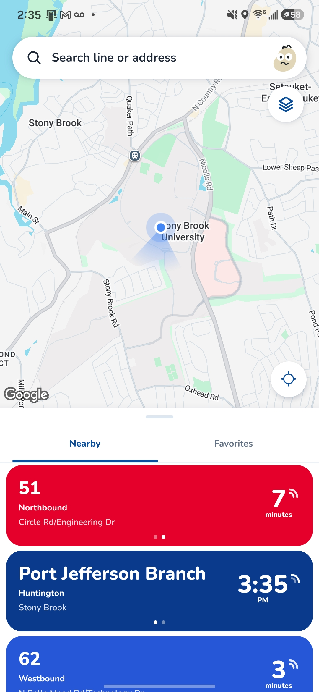
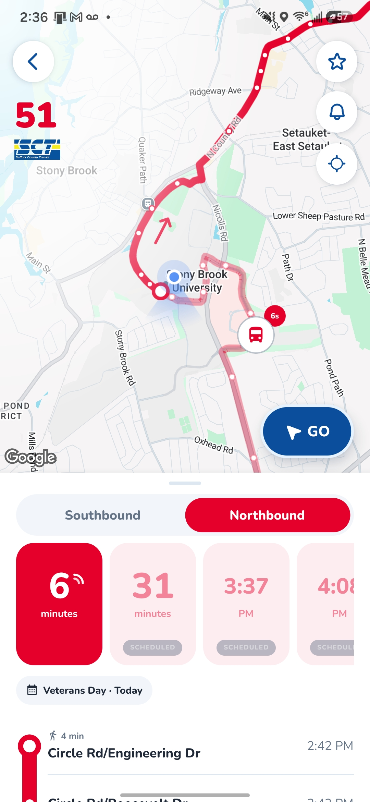
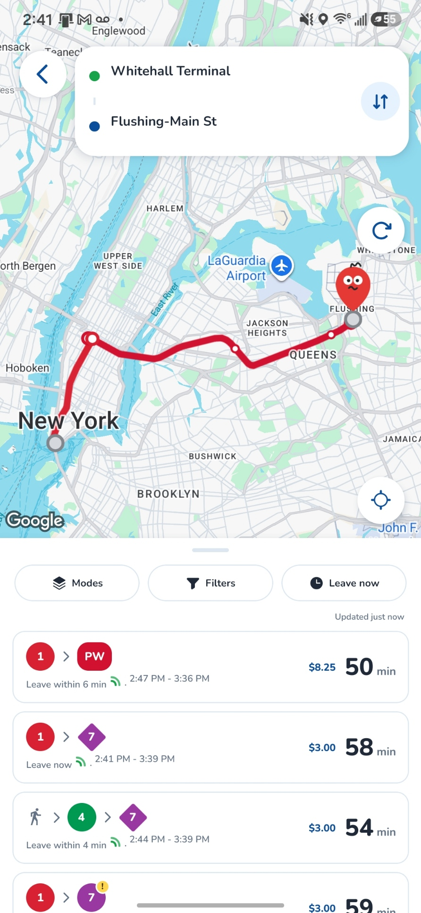
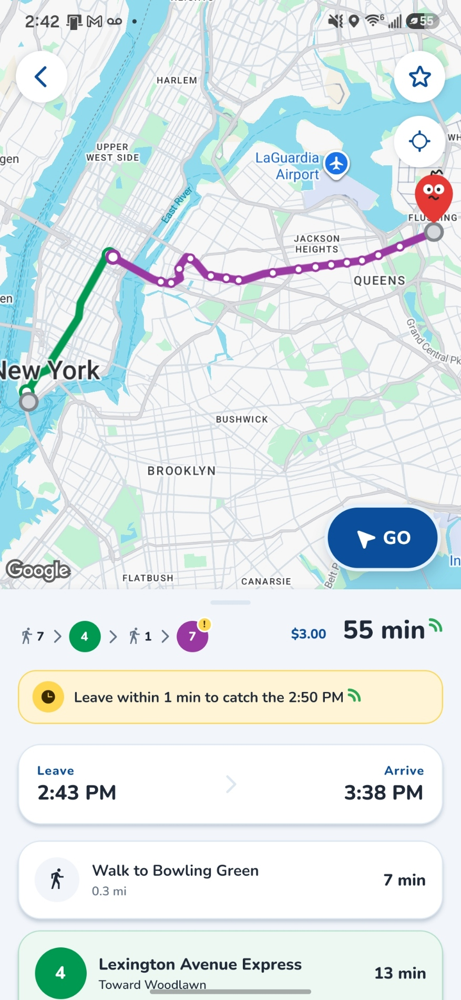

# Pathly

Pathly is a mobile transportation app for riders in New York City and Long Island, inspired by Transit, Citymapper, and Google Maps. Riders can search for transit routes, view nearby stops, compare routes, and navigate to their destinations using real-time and scheduled transit data.

The app is a React Native + Expo client (`mobile/`) backed by Firebase Cloud Functions (`firebase/functions/`). It covers the LIRR, the subway, MTA city buses (all five boroughs and MTA Bus Company), NICE Bus, Suffolk County Transit, NYC Ferry, and the Staten Island Ferry.

Project documents are in `docs/`:

- `M4 Design.ipynb`: the current M4 design document
- `M3 Design.ipynb`: the M3 design
- `M2 Design.ipynb`: the M2 design
- `Proposal.ipynb`: the project proposal (M1)
- `TestPlan.ipynb`: the testing plan

<p align="center">
   
   
   
   
</p>

## Requirements

- Node.js 24.9.0 (see `.nvmrc`)
- npm 11.6.0
- One viewing option:
  - a web browser,
  - Xcode 27 with an iOS 27 simulator,
  - Android Studio with an Android Virtual Device, or
  - a physical iOS or Android phone with Expo Go

## Installation

```sh
git clone https://github.com/Transit-Clone/Pathly.git
cd Pathly
nvm use
npm ci
```

If you don't use `nvm`, install the Node version listed in `.nvmrc` some other way. Use `npm ci` for a reproducible install from the committed lockfile. Use `npm install` only when you are intentionally changing dependencies.

## Local configuration

The app needs Firebase and Google Maps client settings before it can load live data:

1. Obtain the current approved configuration from a project maintainer and save it as ignored `mobile/.env`. The repository does not contain a `.env.example`; [mobile configuration](docs/mobile-configuration.md) lists the key names and platform prerequisites without private values.
2. Configure Firebase (`EXPO_PUBLIC_FIREBASE_*`) and the platform-restricted Maps keys (`GOOGLE_MAPS_ANDROID_API_KEY`, `GOOGLE_MAPS_IOS_API_KEY`, `EXPO_PUBLIC_GOOGLE_MAPS_WEB_API_KEY`). Native Google sign-in also needs the relevant OAuth client IDs; a working web session does not verify native sign-in.
3. Set `ADMIN_EMAILS` (comma-separated) in `firebase/functions/.env.<project-id>`. It's the only admin list: the backend uses it to allow admin-only calls, and `mobile/app.config.js` passes it to the app to decide who sees the admin tools. The default is `admin@gmail.com`. The file stays on your machine, and each deploy builds in the deploying machine's copy, so `npm run deploy:web`, `deploy:backend`, and `deploy:functions` stop if the list is missing or only the default. EAS cloud builds don't have the file; set `ADMIN_EMAILS` as an EAS environment variable for those.
4. Restart the Expo dev server after editing `.env`.

`EXPO_PUBLIC_` values are bundled into the app, so treat them as public and rely on each key's API and app restrictions. Never put backend credentials (the server Maps key, Swiftly, MTA Bus Time) in `mobile/.env`. Git ignores both `.env` and `.secret.local`.

### Destination search (Google Places)

Destination search uses Google Places Autocomplete (Places API (New)). Without a key, search still opens and shows recent places, but typed queries show "Place search is unavailable."

1. In the Google Cloud project that holds the Maps keys, enable **Places API (New)** under **APIs & Services → Library**.
2. Create an API key, or reuse the web Maps key. Under **API restrictions**, restrict it to Places API (New). For web, also add an **HTTP referrers** restriction for your dev and production origins.
3. Add the key to `mobile/.env`:

   ```sh
   EXPO_PUBLIC_GOOGLE_PLACES_API_KEY=your-key
   ```

   If this variable isn't set, the app falls back to `EXPO_PUBLIC_GOOGLE_MAPS_WEB_API_KEY`.

## Running the app

> [!TIP]
> **Quick start:** run `npm start` from the repository root. When the dev server is ready, press a key in the terminal:
>
> - `w`: open in a web browser
> - `i`: open in the iOS Simulator
> - `a`: open in the Android emulator
> - or scan the QR code with a phone that has Expo Go
>
> Press `?` to see all commands. The sections below cover each option in detail.

Run every command from the repository root. Stop the dev server with `Ctrl+C`.

Don't run `npx expo start` from the root. The Expo app lives in `mobile/`, so Expo fails at the root with `Unable to resolve "../../App"` and leaves a stray root `tsconfig.json`. Use `npm start` instead.

`npm start`, `npm run dev`, `npm run dev:ios`, and `npm run dev:android` all run [`scripts/start.mjs`](scripts/start.mjs). Before starting Expo, it:

1. Deletes a stray root `tsconfig.json`, if there is one.
2. Runs `npm install` if `node_modules` is missing or older than any `package.json` or `package-lock.json`.
3. Runs `expo install --check` and warns about packages that don't match the Expo SDK. It doesn't change `package.json`. To fix the versions, run `cd mobile && npx expo install --fix`.
4. Starts Expo from `mobile/` in Expo Go mode. The workspace depends on `expo-dev-client`, which would otherwise make Expo default to development-build mode.

Options after `--` are passed to `expo start`, for example `npm start -- --clear` to clear the Metro cache. If you've installed a custom development build, use `npm start -- --dev-client`.

### Web

```sh
npm run dev:web
```

Open the local URL shown in the terminal.

### iOS Simulator

1. In Xcode 27, open **Xcode → Open Developer Tool → Device Hub**.
2. Start an iPhone simulator with the installed iOS runtime.
3. Run:

   ```sh
   npm run dev:ios
   ```

Expo opens Pathly in the running simulator.

### Android emulator

Install Android Studio, create and start an Android Virtual Device, then run:

```sh
npm run dev:android
```

### Physical iPhone or Android phone

1. Install Expo Go on the phone.
2. On iPhone, create a free Expo account and sign in to it in both Expo Go and the Expo CLI (`npx expo login`).
3. Connect the phone and the computer to the same Wi-Fi network.
4. Run `npm run dev`.
5. When the QR code appears, scan it with the iPhone Camera app, or with **Scan QR code** in Expo Go on Android.

Before scanning, check that the terminal shows `› Using Expo Go`. If the iPhone Camera says **No usable data found**, the server is in development-build mode. Stop it and restart it with `npm start`, not with `npx expo start` from `mobile/`.

If the phone can't load the project, check that both devices are on the same network and that the computer's firewall allows incoming Node connections. You can also switch to Expo's tunnel option from the interactive terminal.

## Commands

| Command                     | Purpose                                                   |
| --------------------------- | --------------------------------------------------------- |
| `npm start` / `npm run dev` | Check dependencies, then start Expo (QR code for Expo Go) |
| `npm run dev:web`           | Start the web app                                         |
| `npm run dev:ios`           | Start Expo and open the iOS Simulator                     |
| `npm run dev:android`       | Start Expo and open the Android emulator                  |
| `npm run lint`              | Lint the mobile workspace                                 |
| `npm run typecheck`         | Type-check the mobile workspace                           |
| `npm test`                  | Run the mobile tests, then the Functions tests            |
| `npm run build`             | Export the Android, iOS, and web bundles to `mobile/dist` |
| `npm run functions:build`   | Compile the Cloud Functions                               |
| `npm run functions:test`    | Build the timetable indexes and run the Functions tests   |
| `npm run functions:shell`   | Open the Firebase Functions shell                         |
| `npm run deploy:functions`  | Deploy Cloud Functions only                               |
| `npm run deploy:backend`    | Deploy Storage rules and Cloud Functions                  |
| `npm run build:site`        | Build the web app and put the site together in `dist/site` |
| `npm run deploy:web`        | Build the site and deploy it to Firebase Hosting          |

These commands run in `firebase/functions` (`npm --prefix firebase/functions run <script>` from the root):

| Command         | Purpose                                                                 |
| --------------- | ----------------------------------------------------------------------- |
| `build:gtfs`    | Build the per-route timetable indexes (add `-- --force` to rebuild all) |
| `build:walking` | Build the walking-graph tiles from an OpenStreetMap extract             |
| `serve`         | Build the indexes and start the local Functions emulator                |
| `logs`          | Show deployed Functions logs                                            |

## Web deployment

The web build is hosted on Firebase Hosting at **https://pathly.web.app**. Open it in a browser on any phone or computer to test the app without running a local dev server.

To publish your latest changes, run:

```sh
npm run deploy:web
```

This exports the web bundle to `mobile/dist`, puts it under `/app` next to the landing page and privacy policy from `website/` (in `dist/site`), and deploys only Hosting. pathly.web.app is the landing page, pathly.web.app/app is the web app, and pathly.web.app/privacy stays where the app and Play listing link to it. It doesn't change Cloud Functions, Firestore, or Storage. You need to be signed in to the Firebase CLI (`npx firebase-tools login`) with access to the `pathly-b7f0f` project. The `EXPO_PUBLIC_` values in your local `mobile/.env` are built into the bundle, so deploy from a machine that has the full config.

## Android release

Android builds run on EAS (`mobile/eas.json`). The package name is `com.pathly.app` and can't change after the first Google Play upload. Run these commands from `mobile/` after `npx eas-cli login`.

### One-time setup

1. **Environment variables.** Ignored `mobile/.env` is not shipped to cloud builders. Configure the required [mobile configuration keys](docs/mobile-configuration.md) in the EAS environment selected by `mobile/eas.json`: `production` for store builds, `preview` for test APKs, or `development` for development clients. Use expo.dev under **Project → Environment variables** or `npx eas-cli env:create`. Client-side `EXPO_PUBLIC_` values end up in the app regardless of their dashboard visibility. Set the canonical `ADMIN_EMAILS` list in the selected environment too.
2. **Firebase Android app.** In the Firebase console, add an Android app with the package `com.pathly.app` and download `google-services.json`. Upload it as an EAS **file** variable named `GOOGLE_SERVICES_JSON`. For local native builds, put it at `mobile/google-services.json` (git ignores it).
3. **Push notifications.** In the Firebase console, create a service account key for Firebase Cloud Messaging (V1) and upload it with `npx eas-cli credentials` → Android → production → Google Service Account → FCM V1.
4. **Signing.** Let EAS generate the upload keystore on the first build, then download a backup with `npx eas-cli credentials`. Google Play App Signing holds the real signing key.
5. **SHA-1 fingerprints.** After the first upload, copy the app signing key's SHA-1 from Play Console → **Test and release → App integrity**. Add it, along with the EAS upload key's SHA-1, to the Android OAuth client (`EXPO_PUBLIC_GOOGLE_ANDROID_CLIENT_ID`), the Android Maps key restriction, and the Firebase Android app. If you enforce App Check, register Play Integrity for the Android app.
6. **Play submissions.** Create a Google Cloud service account with release access in Play Console (**Users and permissions**), and save its JSON key as `mobile/play-service-account.json` (git ignores it). Upload the first `.aab` by hand in Play Console; Google requires that before the API accepts uploads.

### Building and submitting

```sh
npx eas-cli build -p android --profile preview     # installable APK for testing on a phone
npx eas-cli build -p android --profile production  # signed .aab for Google Play
npx eas-cli submit -p android --profile production # upload the latest build as a draft on the internal track
```

`versionCode` increases automatically on each production build. Change `version` in `mobile/app.config.js` for the version people see. Promote releases from internal → closed → production testing in Play Console. A new personal developer account must run a closed test with at least 12 testers for 14 days before it can publish to production.

## Backend

The Cloud Functions in `firebase/functions/` serve live departures, trip plans, and nearby stops. Two generated data sets aren't committed:

- **Timetable indexes.** Build them with `npm --prefix firebase/functions run build:gtfs`. Tests and deploys build them automatically. Without them, the Functions still work locally, just more slowly.
- **Walking-graph tiles.** Build them from an OpenStreetMap extract with `build:walking`. Nearby uses them to find the closest stop on foot, and deploys fail without them.

Backend credentials live in Firebase Secret Manager, never in `mobile/.env`. For the local emulator, copy `firebase/functions/.secret.local.example` to `firebase/functions/.secret.local`.

For deploying or operating the backend, see [docs/backend.md](docs/backend.md). It covers secrets, the walking-tile build, the Routes API, the daily GTFS refresh, production setup, and App Check.
