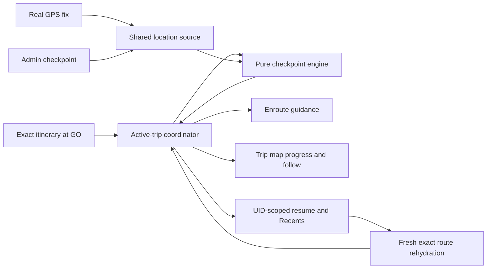

# Design

## Context

See [proposal.md](./proposal.md) for motivation. On `route-nav` at `d3f1ee7`, `HomeScreen` represents an active trip as a transient `Itinerary | null`; `GO` keeps the rider on the planned-trip detail and `END` only clears that state. `PlannedTripDetailView` now passes the exact itinerary after local departure retiming, but alternate departures keep the same itinerary ID. `SharedTripDetailView` is a presentation model that intentionally loses raw step indexes and ISO semantics, so it is not a safe progress model.

`useCurrentLocation` already provides one app-wide real-or-admin-mock coordinate, but it omits accuracy and timestamp, substitutes the Stony Brook fallback when unavailable, and does not refresh on foreground transitions. The web `TripMap` draws the passed location, while native always draws the operating-system location dot; that would make an admin simulation disagree with the native map. Both map implementations currently center only in response to a button, not continuously while navigating.

The routing response comes from Google Routes and is enriched with Pathly's GTFS stop and trip identifiers. Current [Routes API policy](https://developers.google.com/maps/documentation/routes/policies) restricts caching most response content, while the [service-specific terms](https://cloud.google.com/maps-platform/terms/maps-service-terms) permit Routes latitude/longitude caching for up to 30 days and permit place-ID storage. The implementation must therefore keep the exact response in memory for the active run but persist only a resume reference that can safely rehydrate it. Existing Firestore `prevDests` is destination history keyed by place, not a completed-trip model.

## Goals / Non-Goals

**Goals:**

- Use one pure, testable progress engine for real GPS updates and admin-mock updates.
- Freeze the exact retimed departure chosen at `GO`, under a unique session identity.
- Restore a same-account active session after relaunch without permanently storing a Routes response.
- Keep completion, active-state removal, and Recent creation logically idempotent.
- Preserve the redesigned trip-detail hierarchy and every existing app surface.

**Non-Goals:**

- Background location, lock-screen/live-activity guidance, or push notifications.
- Dynamic rerouting, automatic off-route recovery, or street-level turn-by-turn instructions.
- Inferring vehicle boarding from schedule time alone.
- Cross-device active-trip or trip-history sync.
- Replacing the existing Routes/GTFS planning pipeline or adding a navigation SDK.

## Decisions

### 1. Use a dedicated active-trip coordinator and a pure checkpoint engine

Add a `useActiveTrip` coordinator (backed by pure data functions) rather than extending `HomeScreen`'s bare itinerary state or flattening navigation into `TripDetailModel`. The coordinator owns lifecycle, persistence, hydration, completion, and one runtime session:

```ts
type NavigationPhase =
  | 'walking'
  | 'waiting-to-board'
  | 'riding'
  | 'transferring'
  | 'arrived';

type NavigationCursor = {
  checkpointOrdinal: number;
  stepIndex: number;
  phase: NavigationPhase;
  nextStopIndex?: number;
  lastAdvancedAt: number;
};

type ActiveTripRuntime = {
  sessionId: string;
  uid: string;
  itinerary: Itinerary;
  origin: TripEndpointReference;
  destination: TripEndpointReference;
  startedAt: number;
  cursor: NavigationCursor;
  selection: TripSelectionIdentity;
};
```

`sessionId` is generated at `GO` and is the idempotency key for completion. `TripSelectionIdentity` fingerprints the exact departure with the routing itinerary ID plus stable Pathly data where available: transit `tripId`, boarding/alighting identifiers or coordinates, and departure times. Itinerary ID alone is insufficient because `retimeItinerary` does not change it and walking-only results can also collide.

`GO` passes a `StartTripInput` containing the exact retimed `Itinerary`, origin/destination references, and the request criteria needed for rehydration. The runtime copy drops unused alternative-departure arrays to prevent accidental edits. `activeView: { name: 'enroute' }` opens a dedicated screen. Starting a second trip goes through a replacement confirmation; confirming completes the old session with `ended-early` before installing the new one, while cancellation makes no state change.

Alternative considered: keep `isActive` in `PlannedTripDetailView`. Rejected because departure selection, route review, progress state, and recovery errors have different semantics and would make the redesigned shared detail component responsible for domain state.

### 2. Normalize the itinerary into ordered checkpoints and only move forward on spatial evidence

Add a pure `enrouteNavigation` module that turns each raw `TripStep` into an ordered plan:

- a walking step contributes its usable path and endpoint;
- a transit step contributes boarding, known intermediate stops, and alighting;
- transfers are the walk/wait between consecutive transit steps;
- the final path endpoint is the destination checkpoint.

Each checkpoint has a monotonically increasing ordinal and enough source indexes to generate guidance and map styling. `advanceNavigation(plan, cursor, fix, evidence)` returns a new cursor plus pending evidence; it never mutates the session.

`useCurrentLocation` will expose a real `LocationFix` with coordinate, horizontal accuracy, captured time, and source (`real` or `mock`). The Stony Brook service-area fallback remains available to non-navigation screens but is never passed to the engine when status is `unavailable`. App foreground transitions request a fresh fix.

Initial evidence constants are intentionally conservative and centralized for tuning:

- walking endpoint or destination: 45 m;
- named transit checkpoint: 100 m;
- usable transit-path corridor: 120 m;
- threshold expansion by reported horizontal accuracy, with a cap so a very poor fix cannot skip legs;
- two consistent real fixes for a phase/checkpoint transition, or one admin-mock fix because it is authoritative.

A later checkpoint can skip missed updates only when it is unambiguously farther along the current route. Nearest-polyline projection can support that decision, but proximity to an overlapping path or close transfer stops is insufficient by itself. Schedule time is used for labels and as a tie-breaker, never as sole proof of movement or boarding. If evidence is ambiguous, stale, unavailable, or outside the route corridor, the cursor holds and the UI reports the location state. Legs without intermediate stops expose only board/alight progress and do not manufacture a next-stop name or countdown.

Alternative considered: advance solely from scheduled times. Rejected because delays, missed vehicles, and admin time changes would produce false guidance.

### 3. Persist a resume reference, then require an exact fresh match

Store one versioned AsyncStorage document per UID, for example `pathly.navigation.<uid>.v1`, containing both the active resume record and provider-light recent summaries. One coordinator serializes writes so start, cursor change, and completion cannot race each other.

The active persisted shape contains:

- schema version, `sessionId`, UID, start/update timestamps, and cursor;
- route-planning criteria with an absolute original departure request for resume;
- permitted endpoint references (Pathly IDs or place IDs; temporary coordinate inputs carry a saved-at timestamp and are deleted within 30 days);
- the selected departure fingerprint and Pathly-owned GTFS identifiers;
- no full `Itinerary`, polyline collection, copied provider instructions, or completed-trip geometry.

At startup, hydration waits for the authenticated UID, validates the record, and calls an internal `planTripForResume` path using the stored absolute departure request. The backend request schema already accepts an explicit departure instant, so this can reuse the existing callable; the client planner needs an internal absolute-time option. The returned candidates are matched against the complete stored fingerprint. Only an exact match becomes the new in-memory itinerary. The restored cursor is the maximum of the persisted cursor and any unambiguous progress from a fresh fix. A different or merely similar candidate is never substituted.

If planning or matching fails, the coordinator enters `recovery` with Retry and End actions and retains the reference. Corrupt, wrong-UID, unsupported-version, or older-than-24-hours active records are quarantined/cleared safely. A hydration state prevents Home from briefly claiming there is no active trip before restore finishes.

Alternative considered: serialize the exact itinerary into AsyncStorage. Rejected because it conflicts with the repository's existing non-caching posture and is not a safe public-MVP design under Routes policy.

### 4. Keep completed history provider-light and local for this milestone

`RecentTripV1` contains `sessionId`, UID, permitted endpoint references, actual start/end timestamps, `arrived | ended-early`, and Pathly-owned line/trip summaries. It does not retain route paths or a provider response. The coordinator inserts by `sessionId`, sorts newest first, truncates to 20, and removes the active record in the same serialized document update. Repeated completion events therefore remain idempotent.

`TransitSheet` receives recent summaries and renders real cards instead of its empty state. Selecting one reconstructs the origin/destination inputs and opens a fresh Route Results request. Existing `prevDests` is not overloaded: it deduplicates by destination and cannot represent multiple trips, outcomes, or origins. Cross-device history can later introduce a proper `completedTrips` collection plus Firestore rules without changing this engine.

Alternative considered: use `prevDests` as Recents. Rejected because it would silently collapse repeated trips and misrepresent destination history as trip history.

### 5. Build a separate enroute screen on the new trip-detail primitives

Add `EnrouteNavigationView` and reuse the redesigned map-first building blocks (`DetailMapPage`, controls, badges, timeline styling), not `SharedTripDetailView`'s flattened planned-trip model. Its compact guidance panel is derived from the raw plan and cursor and shows:

- a dominant current action;
- next known action/stop;
- route badge and headsign when riding or boarding;
- remaining known stops only when the stop sequence is present;
- arrival clock time and aging time context;
- a non-destructive location/off-route status;
- always-reachable Back, locate, and `END` controls.

Back returns Home without changing the session. Home gains an active-trip Resume card above the normal transit content, so Nearby, Recents, Favorites, search, profile, and admin tools remain usable. Departure controls are absent from the active screen. The existing confirmation component handles ending and replacement with distinct copy.

### 6. Extend both trip maps with explicit location, follow mode, and progress styling

Extend `TripMapProps` with navigation progress, location freshness, and follow-mode inputs. Both implementations draw the explicit `userLocation` marker. Native sets `showsUserLocation={false}` whenever Pathly provides that marker, preventing real GPS from conflicting with an admin mock. A stale fix keeps the last marker with a muted/stale treatment rather than jumping to fallback coordinates.

While follow mode is on, each accepted location update adjusts the camera to include the rider and immediate upcoming segment at a useful navigation zoom. User pan/zoom turns follow off; the current-location button turns it back on. The existing whole-trip reframe remains available as a separate action.

The normalized plan splits route rendering into completed, current, and upcoming portions. Completed geometry is subdued, the current segment is emphasized, and upcoming geometry retains its route identity. Geometry conversion and segment splitting are memoized; camera changes are throttled to accepted fixes so a 10-second/25-meter watch does not create excessive renders.

Alternative considered: leave the native OS location dot enabled. Rejected because it ignores Pathly's persisted mock location and makes the demo visibly inconsistent across platforms.

### 7. Admin simulation changes location; only explicit Reset changes progress

Generate demo checkpoints from the same normalized plan. An admin-only collapsible Demo controls panel on active navigation provides Previous, Next, direct checkpoint selection, and Reset. Previous/Next/selection call `DebugContext.setMockLocation`; the normal `useCurrentLocation` and progress engine consume that change. Moving backward changes the marker but not the monotonic cursor.

Reset is the sole admin exception: it calls a guarded coordinator method for the current `sessionId`, resets its evidence/cursor to the first checkpoint, and moves the mock location there. This makes the full flow repeatable without weakening production transitions. Non-admin callers receive no method or controls. Mock time remains the existing independent admin tool; it need not be coupled to spatial progress.

The Admin Tools cache action must distinguish disposable caches from durable navigation state. It will continue clearing known nearby/live/trip-plan caches but exclude navigation/history keys; a separate explicit destructive action would be required if clearing trip state is added later.

### 8. Test the state machine first, then the complete demo path

Pure unit tests cover checkpoint normalization and every phase: walking, boarding, known stops, sparse stops, transfers with duplicate coordinates, trailing walking, arrival, jitter, stale/poor fixes, forward skips, and no regression. Storage tests cover schema validation, UID isolation, expiry, serialized writes, exact fingerprint match, recovery failure, idempotent completion, and the 20-item cap.

Component/integration tests cover `GO` with an alternate departure, replacement confirmation, Back/Resume, END cancel/confirm, Recents and repeat search, relaunch hydration/recovery, screen-reader labels, and admin visibility. Native/web map tests assert that the explicit mock marker is used, pan pauses follow, locate resumes it, and progress styles change. The final verification runs the existing mobile and backend suites, typecheck, lint, Expo export/build checks, and one manual admin-checkpoint walkthrough on a native target and web.

## Data Flow



## Risks / Trade-offs

- **[Exact route cannot be reproduced after relaunch]** → Keep the reference, show Retry/End, and never substitute a similar itinerary. The in-session demo remains exact.
- **[GPS is poor underground or at adjacent platforms]** → Require conservative evidence, hold the last confirmed cursor, and communicate uncertainty; admin mock fixes stay deterministic.
- **[Foreground-only MVP misses movement while suspended]** → Refresh immediately on foreground and advance only from credible current evidence; do not promise background guidance.
- **[Local history is not cross-device]** → Treat it as the demo/MVP layer and preserve a clean summary model for a later Firestore collection.
- **[Provider-policy interpretation changes]** → Centralize persistable DTOs, annotate provenance, expire temporary coordinates, and keep raw `Itinerary` types out of the storage adapter.
- **[Map-follow updates feel jumpy or expensive]** → Animate only accepted fixes, throttle camera work, and memoize geometry segmentation.
- **[Broad cache clearing deletes an active demo]** → Replace prefix-wide deletion with an allowlist of disposable cache keys and add regression coverage.

## Migration Plan

1. Add the pure types, storage parser, and engine without changing current screens; unknown or absent storage keys resolve to an empty state.
2. Add coordinator hydration and the internal absolute-time resume request, then migrate `HomeScreen` from `activeTrip` to coordinator state.
3. Add the enroute UI/map behavior, Recents cards, and admin demo controls behind the presence of a valid active session.
4. Run automated and manual verification before demo distribution.

Rollback removes the new UI/coordinator reads and returns to the current transient state. Versioned navigation keys are inert to older builds and can be removed by a later targeted cleanup; no remote schema rollback is needed.
